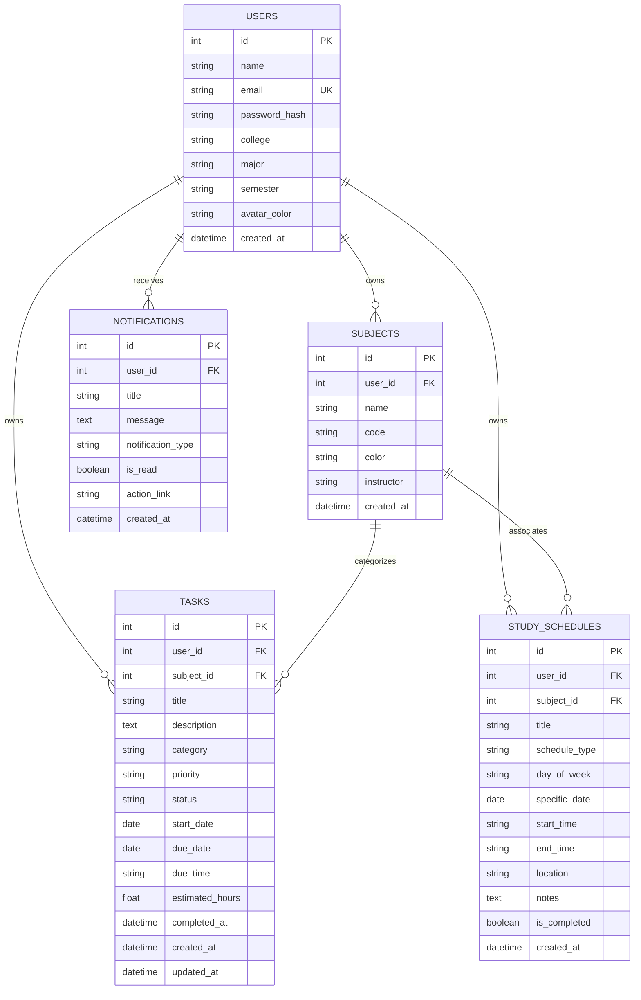

# 🎓 Student Task Manager – Smart Student Productivity System

> A modern, full-stack student productivity and academic workflow management platform engineered with Python, Flask, SQLite, Bootstrap 5, and Chart.js.


---

## 📌 Project Overview

**Student Task Manager** is a full-stack web application designed specifically for college and university students to streamline coursework, manage assignments, organize weekly class timetables, track exam preparation, and monitor semester productivity in real time. 

Built with an emphasis on **clean software architecture**, **data privacy**, and **modern UI/UX design**, this application gives students an intuitive command center with soft lavender and blue aesthetics, intelligent reminders, and interactive performance charts.

---

## 🚀 Core Features

### 1. 🔐 Authentication & Zero-Leakage Privacy
- **Student Registration & Login:** Safe authentication using Werkzeug cryptographic hashing (`scrypt`/`pbkdf2`).
- **Complete Data Isolation:** Every query, filter, update, and deletion is scoped strictly to `current_user.id`. Students can never access or view another student's coursework.
- **Session Management:** Secure HTTP-only cookies with "Remember Me" capabilities.
- **Auto-Provisioning:** Automatically seeds default academic subjects upon registration so students can start organizing immediately.

### 2. 📊 Dynamic Dashboard
- **Key Academic Metrics:** Real-time counters for Total Tasks, Completed, In-Progress, Pending, and Overdue tasks.
- **Semester Velocity:** Visual completion progress bar indicating overall workload finished.
- **Upcoming Deadlines:** Prioritized list of tasks due in the next 7 days with live relative countdowns (`Due Today`, `Due Tomorrow`, `Overdue by X days`).
- **Today's Study Checklist:** Instant-toggle view of the day's scheduled study sessions.
- **Urgent Action Banner:** Prominently alerts students when any task becomes overdue or critical deadlines approach.

### 3. 📝 Complete Task Management (CRUD)
- **Create & Edit:** Set title, rich descriptions/instructions, subject, category (`Assignment`, `Project`, `Exam Prep`, `Reading`, `Lab Work`, `General`), start date, due date, due time, and estimated effort in hours.
- **Priority Matrix:** `High`, `Medium`, and `Low` priority badges.
- **Status Lifecycle:** `Pending` ➔ `In Progress` ➔ `Completed` (with automatic timestamping).
- **Instant Status Quick-Toggle:** One-click AJAX completion toggle directly from cards or tables without reloading the page.
- **Task Detail View:** Dedicated breakdown of individual tasks with countdown chips and action controls.

### 4. 🔍 Multi-Filter, Search & Sorting
- **Real-Time Search:** Search tasks across titles and description text.
- **Multi-Dimension Filters:** Filter simultaneously by Subject, Priority Level, Status, and Due Date range (`Today`, `This Week`, `Overdue`).
- **Flexible Sorting:** Sort by Earliest Due Date, Latest Due Date, Highest Priority, Title (A-Z), or Recently Created.
- **Dual View Modes:** Seamlessly switch between modern **Card Grid View** and structured **Table View**.

### 5. 📅 Study Planner & Timetable
- **Daily Study Checklist:** Daily study goals with quick completion toggles.
- **Weekly Class Timetable:** Monday-to-Sunday interactive matrix displaying recurring lecture and study blocks with start/end times and locations.
- **Exam Preparation Tracker:** Targeted revision sessions and milestones tied directly to course tests.

### 6. 📆 Full Interactive Calendar
- Powered by **FullCalendar 6**: Visual monthly and weekly grid views.
- Color-coded events synchronized to individual subject colors and task completion statuses.
- Interactive modal on event click with complete task metadata and direct edit/view links.

### 7. 📈 Productivity Analytics (Chart.js)
- **Weekly Task Completion (Bar & Line Chart):** Tracks tasks completed vs. created over the past 7 days.
- **Monthly Productivity Trend (Area Chart):** 6-month historical completion trajectory.
- **Subject-Wise Distribution (Doughnut Chart):** Workload share across enrolled courses.
- **Priority-Wise Distribution (Doughnut Chart):** Balance between High, Medium, and Low tasks.
- **Task Status Breakdown (Doughnut Chart):** Completed vs. In-Progress vs. Pending proportions.
- **Productivity Index:** Dynamic 0-100 score reflecting on-time performance and completion velocity.

### 8. 🔔 Intelligent Notification & Reminder System
- **Automated Overdue Alerts:** Dynamically detects tasks that passed their due date and issues priority notices.
- **Upcoming Deadline Reminders:** Notifies students 48 hours prior to impending deadlines.
- **Navbar Alert Center:** Badge counter with recent notification preview drawer and a dedicated notification management page.

### 9. 🎨 Modern UI/UX Design System
- **Palette:** Clean white backgrounds (`#FFFFFF`, `#F8F9FE`), soft lavender accents (`#6C5CE7`), sky blue tones (`#0984E3`), and fresh mint status indicators (`#00B894`).
- **Typography:** Sleek geometric sans-serif using **Plus Jakarta Sans**.
- **Components:** Rounded cards (`18px`), subtle elevation shadows, soft pill badges, responsive collapsible sidebar, and friendly empty states.

---

## 🛠️ Technology Stack

| Layer | Technologies |
|---|---|
| **Backend** | Python 3.10+, Flask 3.x, Flask-Login, Flask-WTF, Werkzeug |
| **Database & ORM** | SQLite 3, SQLAlchemy 2.x, Flask-SQLAlchemy |
| **Frontend Framework** | HTML5, CSS3, JavaScript (ES6+), Bootstrap 5.3, Bootstrap Icons |
| **Data Visualization** | Chart.js 4.4 |
| **Calendar Engine** | FullCalendar 6.1 |
| **Security** | CSRF Protection, Password Hashing, Parameterized Queries, Route Guards |

---

## 🗄️ Database Architecture

The SQLite database (`database/student_task_manager.db`) consists of 5 normalized relational tables:



---

## 📁 Project Structure

```
student-task-manager/
│
├── app.py                     # Main Flask application and route controllers
├── models.py                  # SQLAlchemy models (User, Subject, Task, Schedule, Notification)
├── test_app.py                # Comprehensive test suite (9 test cases, 100% pass)
├── seed.py                    # Demo database seeder script
├── requirements.txt           # Python package dependencies
├── README.md                  # Complete technical documentation
│
├── database/
│   └── student_task_manager.db # SQLite database instance (auto-created)
│
├── templates/
│   ├── base.html              # Base master template (Sidebar, Topbar, Alerts)
│   ├── dashboard.html         # Overview dashboard & KPI cards
│   ├── auth/
│   │   ├── login.html         # Student login page
│   │   └── register.html      # Registration page
│   ├── tasks/
│   │   ├── index.html         # Task list (Search, Multi-Filter, Grid/Table view)
│   │   ├── form.html          # Add & Edit Task form
│   │   └── detail.html        # Single task details view
│   ├── planner/
│   │   └── index.html         # Study Planner, Daily Checklist & Weekly Timetable
│   ├── calendar/
│   │   └── index.html         # Interactive FullCalendar view
│   ├── analytics/
│   │   └── index.html         # Chart.js productivity graphs & metrics
│   ├── subjects/
│   │   └── index.html         # Subjects & course catalog management
│   ├── notifications/
│   │   └── index.html         # Notification center & alerts
│   └── profile/
│       └── index.html         # Student profile settings & password change
│
├── static/
│   ├── css/
│   │   └── style.css          # Custom modern lavender & blue UI styles
│   ├── js/
│   │   └── main.js            # Frontend JavaScript (AJAX toggles, CSRF, alerts)
│   └── images/
│       └── logo.svg           # Application logo and favicon
│
└── utils/
    ├── __init__.py            # Package initialization
    └── helpers.py             # Dashboard statistics, analytics calculator, notification sync
```

---

## ⚡ Installation & Execution Guide

### Prerequisites
- Python 3.10 or higher installed on your system.
- PowerShell or Command Prompt on Windows (or Terminal on macOS/Linux).

### Step-by-Step Setup

1. **Open PowerShell and navigate to the project directory:**
   ```powershell
   cd "c:\Users\pandi\OneDrive\Desktop\student task manager"
   ```

2. **Create and activate the virtual environment:**
   ```powershell
   python -m venv venv
   .\venv\Scripts\activate
   ```

3. **Install the dependencies:**
   ```powershell
   pip install -r requirements.txt
   ```

4. **(Optional) Seed Demo Showcase Data:**
   To instantly preview the dashboard with realistic assignments, subjects, schedules, and analytics:
   ```powershell
   python seed.py
   ```
   *Demo credentials:*
   - **Email:** `alex@university.edu`
   - **Password:** `password123`

5. **Start the Flask Application:**
   ```powershell
   python app.py
   ```

6. **Open in your browser:**
   Navigate to [http://127.0.0.1:5000](http://127.0.0.1:5000)

---

## 🧪 Automated Testing

The project includes an end-to-end integration and security test suite testing authentication, CRUD, filters, scheduler, calendar API, analytics API, and student data isolation.

To execute the test suite:
```powershell
.\venv\Scripts\python test_app.py
```

Expected output:
```
Ran 9 tests in ~4s

OK
```

---

## 🔒 Security Implementations

1. **Password Hashing:** Passwords are never stored in plaintext; salted hashes are generated via `werkzeug.security.generate_password_hash`.
2. **CSRF Protection:** Every state-altering HTTP form and AJAX request is protected by `Flask-WTF` tokens validated against the student's active session.
3. **Strict Ownership Scoping:** All operations (`Task.query.filter_by(id=task_id, user_id=current_user.id)`) strictly verify ownership, eliminating Insecure Direct Object References (IDOR).
4. **SQL Injection Defense:** All database interactions utilize SQLAlchemy ORM with parameterized statements.
5. **Route Protection:** All application views require authentication via `@login_required`.

---

## 🔮 Future Enhancements

- 📱 Push notifications via Web Push API / Service Workers.
- 📥 Export course schedules to `.ics` (Google Calendar & Apple Calendar format).
- ⏱️ Integrated Pomodoro Study Timer with session logs.
- 📄 Syllabus PDF upload with automatic deadline parsing.
- 👥 Collaborative study group shared checklists.

---

## 👨‍💻 Author & Portfolio Note

Developed as a showcase portfolio project demonstrating:
- Production-grade Flask backend architecture with clean separation of concerns.
- Enterprise-grade security practices (CSRF, ownership verification, password hashing).
- Aesthetic UI/UX design with responsive CSS, interactive Chart.js visualizations, and asynchronous JavaScript interactions.
"# student-task-manager" 
"# student-task-manager" 
"# student-task-manager-" 
"# student-task-manager-" 
